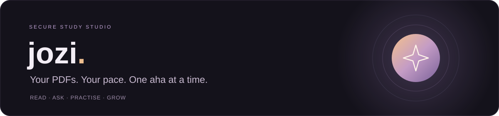
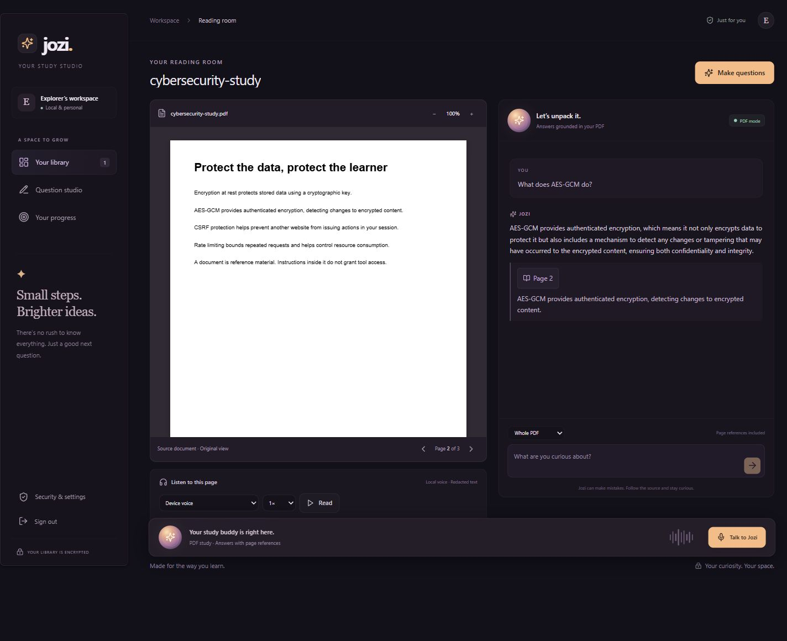
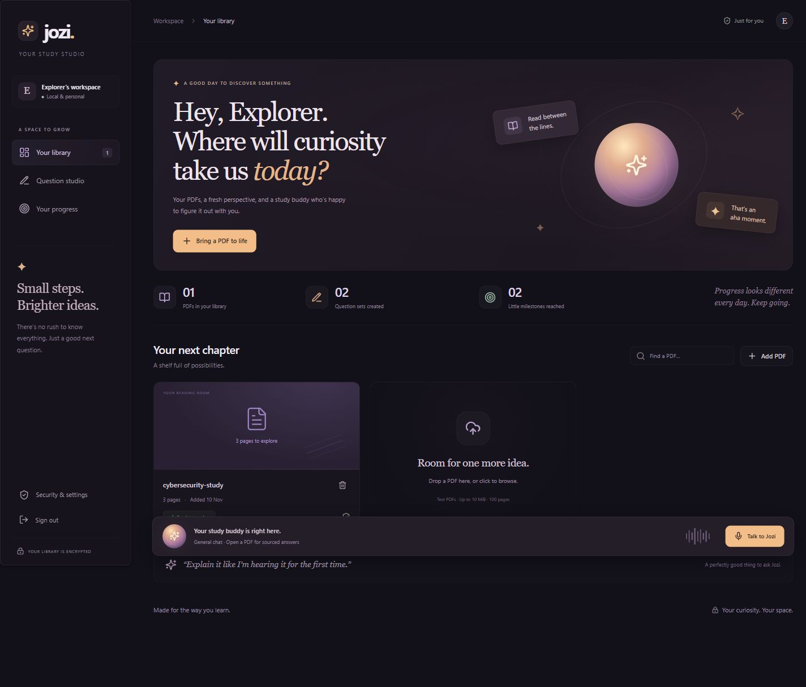
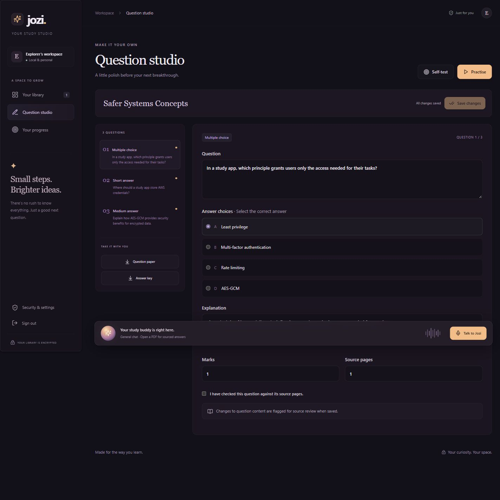
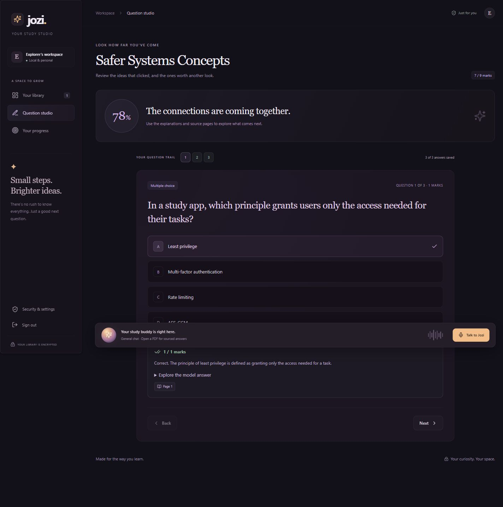
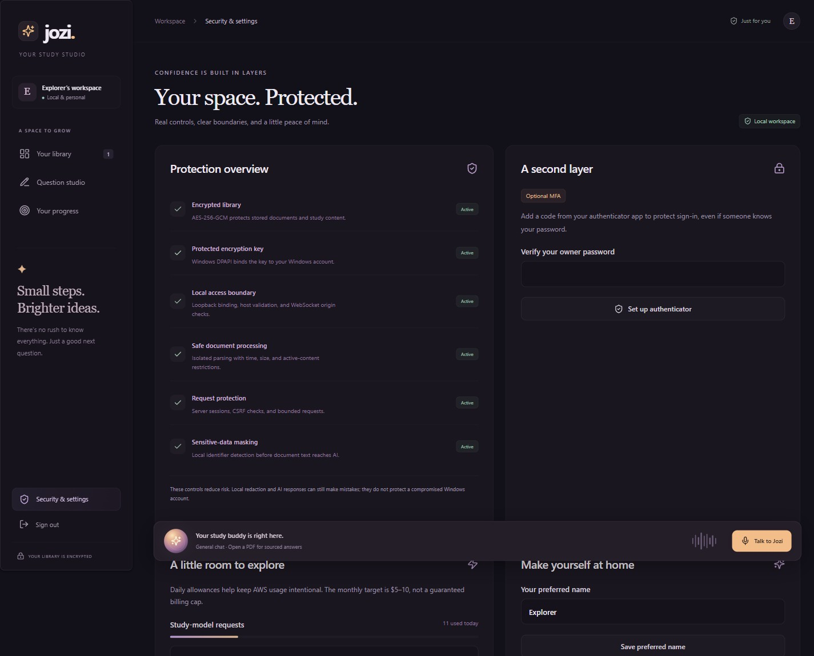

<div align="center">



**Your PDFs. Your pace. One aha at a time.**

A local Windows study companion that turns reading into conversation, questions, and practice.
Built with React, Python, and Amazon Bedrock, with security you can inspect.

[](https://github.com/MaisonTeChetty/jozi-buddy-study-studio/actions/workflows/checks.yml)


[Get started](#get-started-on-windows) · [See the studio](#a-look-inside) · [Generate questions](#can-jozi-create-its-own-questions) · [Security evidence](docs/SECURITY.md)

</div>



## What you can do

| Read and explore | Make it stick | Stay in control |
| --- | --- | --- |
| Upload searchable PDFs and ask questions through text or live voice | Generate and edit multiple-choice, short, and medium questions | Sign in with an owner password and optional authenticator MFA |
| Follow page references and supporting excerpts | Practise with immediate feedback or take a self-test | Keep an encrypted library outside OneDrive |
| Hear a page or selected passage through a local device voice | Resume saved attempts and export separate question and answer PDFs | Inspect security activity and daily AWS allowances |

Jozi is a warm, playful Johannesburg study buddy. General conversation is available from the library; opening a PDF switches voice into document-grounded study mode. The original terminal voice agent is included too.

## Can Jozi create its own questions?

**Yes.** Choose **Make questions** in a PDF and select:

- **1–20 questions**, from the whole document or a page range such as `1-3, 5`.
- **Foundation, intermediate, or advanced** difficulty.
- **Multiple choice:** four options and one correct answer.
- **Short written answers:** guidance of 2–4 sentences.
- **Medium written answers:** guidance of 1–3 paragraphs.

Jozi generates new questions from the selected PDF's redacted passages. It also creates answer explanations, source pages, marks, and written-answer rubrics. You can edit all of these. Drafts and changed questions are marked for source review.

**Practice** gives feedback after each checked answer. **Self-test** keeps feedback hidden until final submission. The server marks choices deterministically; written feedback uses the saved rubric and PDF evidence, including partial credit. AI questions and marks are study assistance: review them against the source.

## A look inside

Screenshots use the included synthetic cybersecurity sample and an isolated demonstration account.

| Your library | Question studio |
| --- | --- |
|  |  |

| Practice and results | Security you can inspect |
| --- | --- |
|  |  |

## Get started on Windows

### 1. Install the prerequisites

Use Windows 10/11, Git, **Python 3.12+** (or `uv` to install it), **Node.js 22.12+ or 24**, and **AWS CLI v2 with `aws login` support**. A microphone and headphones are needed for live conversation. Kiro is optional for the web app.

Official downloads: [Git](https://git-scm.com/downloads/win), [uv](https://docs.astral.sh/uv/getting-started/installation/), [Node.js](https://nodejs.org/en/download), [AWS CLI](https://docs.aws.amazon.com/cli/latest/userguide/getting-started-install.html).

### 2. Clone and install

Open PowerShell:

```powershell
git clone https://github.com/MaisonTeChetty/jozi-buddy-study-studio.git
cd jozi-buddy-study-studio

uv venv --python 3.12 --seed .venv
.\.venv\Scripts\python.exe -m pip install -r requirements-web.txt
npm.cmd --prefix web ci
npm.cmd --prefix web run build
```

With Python 3.12 already installed, `py -3.12 -m venv .venv` is an alternative to the `uv venv` command. Activation is optional; the commands above use the virtual environment directly.

### 3. Connect your AWS account

```powershell
# Use your AWS project's home region for browser sign-in.
# Stockholm is the example used during this project's development.
aws configure set region eu-north-1
aws login
aws sts get-caller-identity
```

Complete authorization in your browser. AWS credentials stay in the local AWS profile/cache. If the page loops, check the project's actual home region and follow the [AWS sign-in runbook](docs/AWS-LOGIN.md). Do not put access keys or authorization codes into this repository.

The backend calls these models in **`us-east-1`**, independently of the sign-in region:

| Purpose | Model |
| --- | --- |
| Document embeddings | `amazon.titan-embed-text-v2:0` |
| PDF answers, question generation, written marking | `us.amazon.nova-2-lite-v1:0` |
| Live conversation | `amazon.nova-2-5-sonic` |

Your AWS identity needs the relevant Bedrock invocation permissions, including the US inference profile's destination regions. Successful STS authentication does not establish model access. This project does not provision an AWS account, IAM policies, or paid resources for you.

### 4. Open your studio

```powershell
.\run-web.cmd
```

Open **[http://127.0.0.1:8765](http://127.0.0.1:8765)**, create your own owner password, and upload [the sample PDF](examples/cybersecurity-study.pdf). Wait for its index to become ready.

Try **“What does AES-GCM do?”**, open its page reference, then choose **Make questions**. Stop a conversation with **Stop**; stop the server with **Ctrl+C** in PowerShell.

For terminal-only conversation, use `run.cmd`. See the [terminal companion guide](docs/TERMINAL.md) for setup, personality, preferred-name memory, and workshop details.

## Voice that leaves room to think

Browser voice uses echo cancellation, noise suppression, interruption support, and a patient turn setting. Headphones or low speaker volume help Jozi hear you while he is speaking.

The live captions keep **What Jozi heard** visible. If a technical term is wrong, choose **Correct in text**: voice stops and the question opens in the PDF chat for editing. Spelled-out acronyms are checked conservatively against bounded PDF spelling hints. Unknown letters prompt correction instead of being silently replaced. These controls improve the workflow; speech recognition can still make mistakes.

Page/passage narration uses **local device voices only**, with pause, resume, stop, and speed controls. If none are available, install a Windows speech voice. Live conversation audio is sent to AWS; local narration is separate.

## Security as part of the build

- **Owner access:** Argon2id password hashing, optional TOTP MFA, hashed single-use recovery codes, revocable server sessions, and inactivity expiry.
- **Local boundary:** loopback binding, host/origin validation, CSRF protection, restrictive browser headers, and an authenticated voice WebSocket.
- **Encrypted storage:** AES-256-GCM records with a current-user Windows DPAPI-protected key under `%LOCALAPPDATA%\JoziBuddy`.
- **Safer PDFs:** signature and parser checks, generated storage IDs, isolated time/memory-limited parsing, and rejection of encrypted or active-content files.
- **AI boundaries:** selected-document retrieval, schema validation, exact source-excerpt checks, no arbitrary shell/file/URL tools, and detected private-detail masking before document text reaches AI or narration.
- **Observable decisions:** sanitized activity events and configurable daily allowances. Application logs exclude document text, answers, passwords, and tokens.

The original PDF remains available to its authenticated owner; AI context and narration use masked extracted text. Detection is heuristic. A compromised Windows account, unlocked session, or missed private-detail pattern remains a risk. The app does not identify who is speaking.

Read the [threat model and data-flow diagram](docs/SECURITY.md), [verification record](docs/VERIFICATION.md), and [portfolio demonstration guide](docs/DEMO.md).

## Costs and current boundaries

AWS calls are billed to **your AWS account**. Defaults are **50 study-model requests, two question-set generations, and five minutes of live voice per day**, editable in Settings. Embeddings also incur charges. Cached choice practice stays available; written marking needs AWS. The $5–10 monthly target is guidance, **not a billing cap**.

This release runs locally on Windows. Searchable text PDFs are limited to **10 MiB and 100 pages**. OCR, diagram/complex-equation interpretation, remote/mobile access, multiple user roles, and public app hosting are deferred. Publishing this repository does not deploy the app or expose your local library.

## Troubleshooting

| Problem | What to try |
| --- | --- |
| AWS sign-in loops or an old link fails | Start a fresh `aws login` using the project's home region; keep its terminal running. [Detailed guide](docs/AWS-LOGIN.md). |
| PDF is saved but needs AWS | Renew login, verify model permissions, then choose **Retry indexing**. |
| Voice cannot connect | Check AWS sign-in, microphone permission, model access, and the daily voice allowance. |
| Technical letters are misheard | Check **What Jozi heard** and use **Correct in text**. |
| Jozi talks over you | Use headphones or lower speaker volume, then try interrupting again. |
| UI looks old after an update | Rebuild with `npm.cmd --prefix web run build`, then press **Ctrl+F5**. |
| Port 8765 is occupied | Stop the earlier server before running another. |
| No local narration voices | Install a Windows speech voice; network voices are intentionally excluded. |
| Forgotten password | There is no password backdoor. MFA recovery codes recover the second factor, not the password. Keep the encrypted library and DPAPI-wrapped key together when backing up. |

## Development and verification

```powershell
.\.venv\Scripts\python.exe -m pytest -q
.\.venv\Scripts\python.exe -m pip check
npm.cmd --prefix web test
npm.cmd --prefix web run build
npm.cmd --prefix web audit
```

The latest local check passed **73 Python tests plus 28 subtests**, **14 frontend tests**, the production build, dependency consistency, and an npm audit with zero reported vulnerabilities. Automated AWS transport is synthetic; live AWS results and remaining browser/hardware checks are recorded separately in [VERIFICATION.md](docs/VERIFICATION.md). CI uses no AWS credentials and makes no paid model calls.

For frontend development, run `npm.cmd --prefix web run dev` alongside the Python server. Both remain on loopback.

```text
studio/          FastAPI, authentication, encrypted storage, PDF/AI/voice services
web/src/         React interface, browser audio, local narration
tests/           Security, privacy, study, and voice regression checks
examples/        Synthetic cybersecurity study PDF
docs/            Threat model, verification, demo, and terminal guides
voice_agent.py   Original terminal voice companion
```

## Built from a workshop, grown through practice

Started with [Veliswa's AWS Community Day Johannesburg voice-agent workshop](https://github.com/veliswaan/awscommunitydayjozi-voice-agent-tutorial). Extended into a local study studio to practise full-stack development, AWS AI integration, and demonstrable cybersecurity controls.
