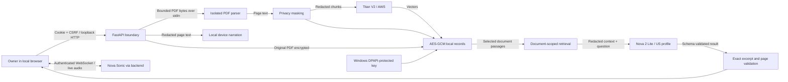

# Jozi Buddy security model

This release serves one owner on a Windows computer. It listens on IPv4 loopback, keeps its encrypted library under `%LOCALAPPDATA%\JoziBuddy`, and calls AWS from Python. It does not provide remote access, identity verification of a speaker, or protection against malware running as the Windows user.

## Data flow and trust boundaries

Original PDFs are visible only after authentication. The viewer displays originals, so private details may be visible to the owner. Embeddings, model context and local narration use masked extracted text. Live microphone speech is streamed to AWS directly; masking a PDF does not mask microphone audio. Do not speak secrets into the assistant.

## Threat model

| Threat | Implemented control | Remaining boundary |
| --- | --- | --- |
| Stolen password or guessing | Argon2id, five authentication attempts per minute, optional TOTP, hashed single-use recovery codes | Malware and an unlocked authenticated browser remain outside the model |
| Session theft/replay | Random opaque tokens, server-side hashes, HttpOnly/SameSite=Strict cookies, logout revocation, 30-minute inactivity and 12-hour absolute expiry; MFA changes revoke other sessions | Local HTTP cookies cannot use Secure; do not expose the server through a proxy/tunnel |
| Cross-site or DNS rebinding request | Host allowlist, origin allowlist, CSRF token on mutations, WebSocket origin and CSRF checks | A hostile process already running locally can contact loopback |
| Library stolen from disk | AES-256-GCM with random nonces and record-bound additional data; key protected with current-user DPAPI | Record kinds, UUID relationships, timestamps, usage counters and ciphertext lengths remain metadata; DPAPI is not a second Windows identity |
| Malicious PDF | Extension/signature/parser validation; generated IDs; reject encrypted PDFs, JavaScript, launch/open actions and embedded files; 10 MiB/100 pages; one parser process, 20-second and 384 MiB process-memory limits | Structural checks are not antivirus, content disarm or a full OS sandbox; keep parser and viewer dependencies current |
| Parser failure or resource exhaustion | Separate Windows job-controlled process; no usable document committed on parsing failure; five uploads/minute | A document that passes parsing but cannot access AWS stays saved with a retry status |
| PDF prompt injection | Source text marked untrusted, retrieval restricted to selected document, no shell/file/network tools for study models, schema and exact-citation validation; PDF voice forces the scoped tool and gates audio until a current-turn result is available | Model instructions and semantic grounding are probabilistic; exact quotes do not prove that an answer logically follows |
| Private information reaches AI | Local contact, phone, address, SA ID, financial-identifier and credential patterns; repeated masking before embedding/model/narration | Detection is heuristic, can miss unusual formats and can mask legitimate study numbers; review material before uploading |
| Answer-key disclosure during practice | Server-owned attempt snapshot; answer/rubric/explanation fields excluded; self-test grades hidden until submission; server-side MCQ marking | The owner can deliberately open the editor or answer-key export; this is a study aid, not a proctored exam |
| Unexpected AWS cost | Two concurrent text/embedding calls and one active voice connection; owner-configurable daily limits; defaults 50 text calls, two quiz generations, 300 voice seconds; cached vectors and saved MCQ practice | Embeddings are bounded by uploads, not the text allowance. Retries consume allowance. Application limits are not an AWS billing cap |
| Sensitive logs | Fixed event vocabulary and reason codes; no document text, answer content, passwords or tokens in application activity | AWS and browser tooling have their own data handling; exported files are intentionally plaintext |

## Implementation map

- `studio/auth.py`, `studio/app.py`: owner sessions, MFA, CSRF and API boundaries.
- `studio/storage.py`: encryption, DPAPI wrapping, quota transactions and cascaded deletion.
- `studio/pdf_worker.py`, `studio/documents.py`: upload validation and isolated parsing.
- `studio/privacy.py`, `studio/ai.py`: masking, document retrieval and schema/citation checks.
- `studio/voice.py`, `web/src/audio.ts`: authenticated voice transport and microphone cleanup.
- `studio/voice_model.py`: forced PDF tool selection and a per-turn audio gate. Strands is pinned to 1.62.0 because its prompt-start adapter does not expose Nova's documented tool-choice option; review the adapter and its tests before upgrading.
- `tests/test_studio.py`: reproducible security regression cases, using an explicit fake AWS transport only in tests.

## Operations

Keep the Windows account locked when away. Store MFA recovery codes privately; they are shown once. There is no password backdoor. Preserve the encrypted database and DPAPI-wrapped key together, under the same Windows identity. Losing that key can make the library unrecoverable. Deleting a document removes its associated PDF, extracted pages, vectors, question sets and attempts from active application records; this does not promise forensic erasure from backups or storage media. Do not commit `.memory`, `.aws`, databases, exported private PDFs or recovery codes.

The terminal agent keeps its existing separate `.memory/user.json`; the studio imports a validated preferred name once during owner setup and stores its own encrypted profile. Anyone using the microphone in an authenticated session may ask for that preferred name. Other personal details are refused through model instructions; speaker identity is not authenticated.

## References

- [OWASP file upload guidance](https://cheatsheetseries.owasp.org/cheatsheets/File_Upload_Cheat_Sheet.html)
- [AWS local-development login](https://docs.aws.amazon.com/cli/latest/userguide/cli-configure-sign-in.html)
- [Nova 2 Lite model documentation](https://docs.aws.amazon.com/bedrock/latest/userguide/model-card-amazon-nova-2-lite.html)
